# Unity Lobby Flow

캐릭터 로비와 챕터 세 개로 **비동기 로딩의 리소스 수명과 Addressables 콘텐츠 업데이트**를 검증한 Unity 클라이언트 기술 데모입니다. 캐릭터 미리보기와 시즌 코스튬을 선택하고, 필요한 콘텐츠를 받은 뒤 챕터에 진입합니다.

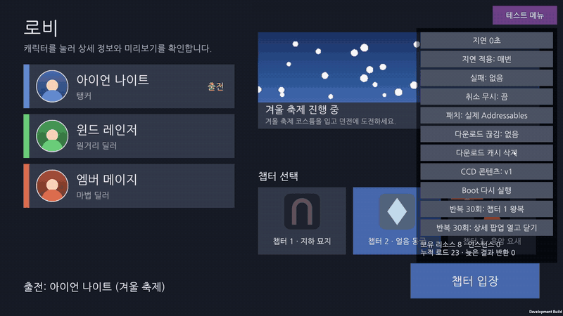

Windows 개발 빌드에서 CCD 콘텐츠를 v1에서 v2로 고르고 Boot를 다시 실행하면, 앱을 다시 시작하지 않고 카탈로그를 갱신한 뒤 바뀐 시작 콘텐츠 17KB를 받아 봄 로비로 들어갑니다.

| v1 겨울 | v2 봄 |
|---|---|
| 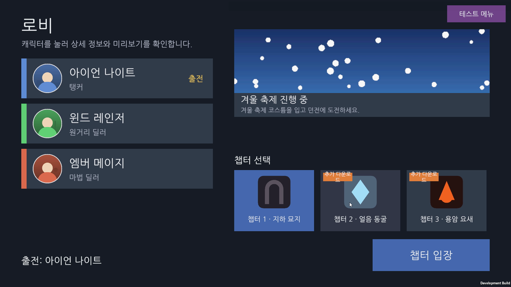 | 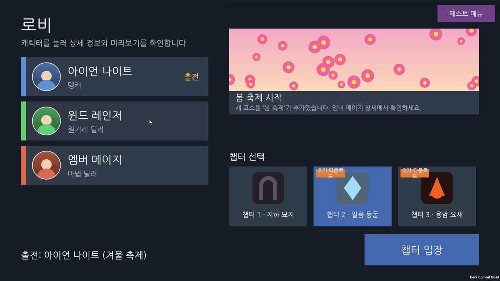 |

| 대표 결과 | 확인 방법 |
|---|---|
| Windows v1 플레이어에서 봄 콘텐츠로 업데이트 | 서버 요청 로그에서 바뀐 시작 패치 번들과 챕터 2만 다시 받고, 챕터 3과 로컬 번들은 요청하지 않음(기록의 후속 2절). [패치 기록](docs/records/2026-11-04-content-update-v2.md) |
| 챕터 2 다운로드 약 2.9MB → 79KB → 21KB | 중복 폰트를 로컬 그룹으로, 중복 셰이더를 공유 그룹으로 분리했습니다. [폰트 개선 기록](docs/records/2026-11-04-content-update-v2.md), [공유 그룹 개선 기록](docs/records/2026-11-05-ccd-v1-v2.md) |
| 미리보기 요청이 겹쳐도 최신 요청만 표시 | PlayMode 테스트에서 완료 순서를 제어해 늦은 응답 반환, 닫은 뒤 도착한 결과 반환, 실패 후 재시도, 교체 시 반환을 확인했습니다. [테스트 코드](Assets/LobbyFlow/Tests/PlayMode/PreviewPresenterTests.cs) |

## 직접 재현하기

Windows와 Unity 6000.3.9f1에서 로컬 콘텐츠 서버로 겨울 v1에서 봄 v2로 바뀌는 과정을 재현할 수 있습니다. Unity CCD 계정이나 키는 필요 없습니다.

1. 저장소를 복제하고 `git fetch origin content/v2`를 실행합니다.
2. Unity의 **Tools ▸ Addressables Delivery ▸ 빌드 창**에서 `LocalServer` 프로필을 선택합니다. **전체 빌드 (기준 갱신)** 후 **Windows 개발 빌드**를 만듭니다.
3. 빌드 창에서 **콘텐츠 서버 ▸ 시작**을 누르고 `Builds/Windows/LobbyFlow.exe`를 실행합니다. 겨울 배너와 챕터 2 다운로드를 확인한 뒤 앱을 닫습니다.
4. 다음 명령으로 원격 콘텐츠를 바꿉니다.

   ```bash
   git restore --source=origin/content/v2 -- Assets/LobbyFlowContent/Remote
   ```

   Unity 창을 눌러 바뀐 파일을 다시 읽게 한 뒤 **콘텐츠 업데이트 빌드**를 실행합니다. **주의:** **전체 빌드**를 누르면 2단계에서 만든 기준이 지워집니다.
5. 2단계에서 만든 플레이어를 다시 실행합니다. 봄 배너와 신규 코스튬을 확인하고, 챕터 2에 들어가 서버 로그에서 어떤 번들이 다시 요청되는지 확인합니다.

테스트용 파일을 정리하는 방법과 CCD 공개 주소 연결 확인은 [패치 재현 가이드](docs/guides/local-patch-test.md)에 있습니다.

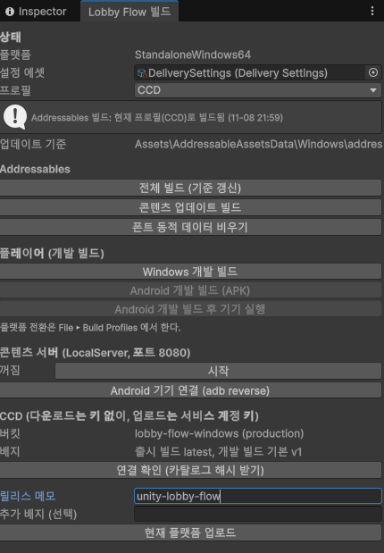

빌드 창은 Addressables 빌드가 현재 프로필과 맞지 않으면 플레이어 빌드와 업로드를 막습니다.

## 로딩과 리소스 수명

```text
Boot → 카탈로그 확인 → 필요한 시작 콘텐츠 다운로드 → Lobby
Lobby → 캐릭터 상세 팝업 → 미리보기 또는 시즌 코스튬 선택
Lobby → 챕터 1(내장) 또는 챕터 2/3(진입 시 필요한 콘텐츠 다운로드) → Lobby
```

| 받을 크기 확인 | 받는 중 |
|---|---|
| 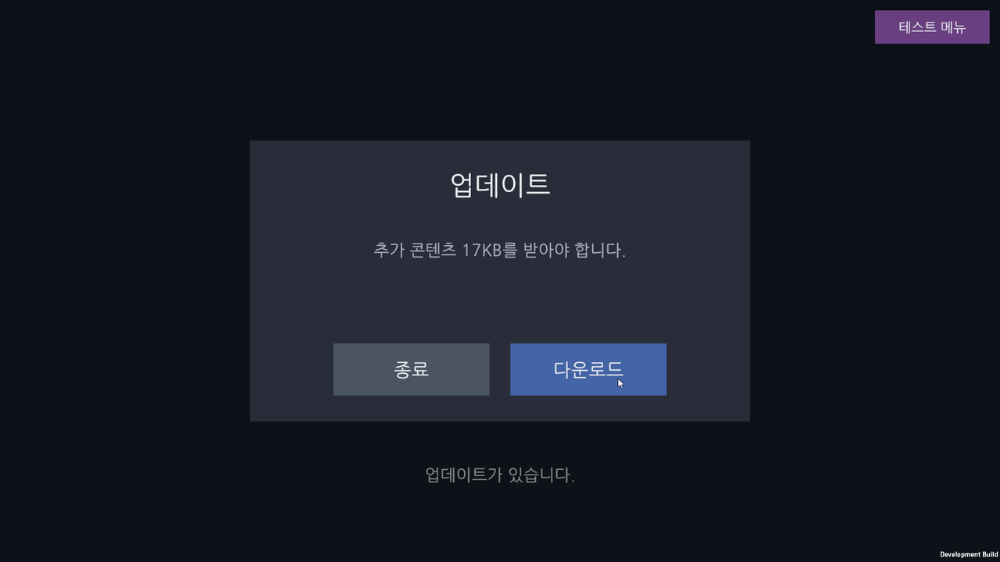 | 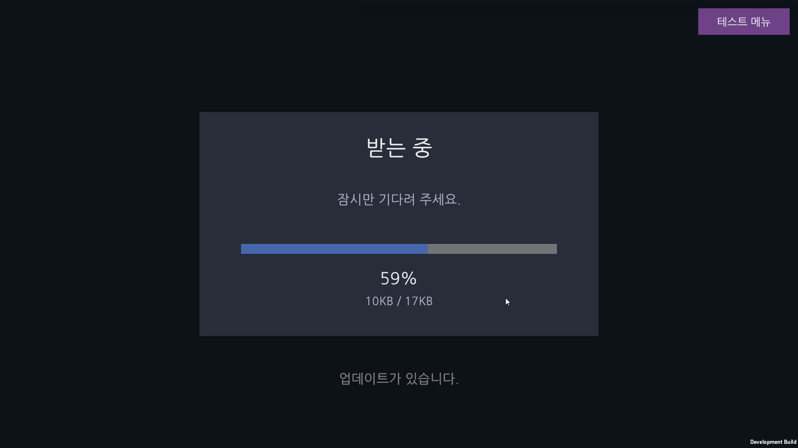 |

카탈로그 확인에 실패하면 `patch_boot` 콘텐츠를 이미 다 받아 두었는지 확인합니다. 받아 두었으면 저장된 콘텐츠로 로비를 열고, 아니면 오류와 재시도를 표시합니다.

| 네트워크를 끊고 시작 | 연결 후 재시도 |
|---|---|
| 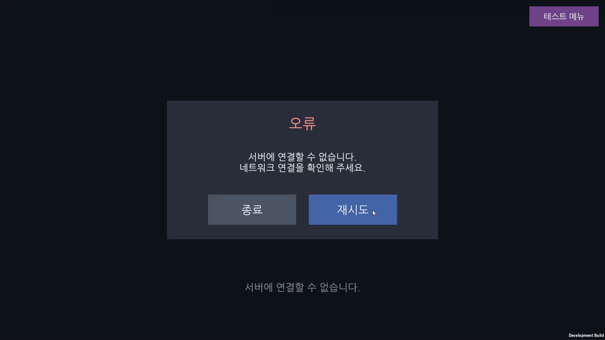 | 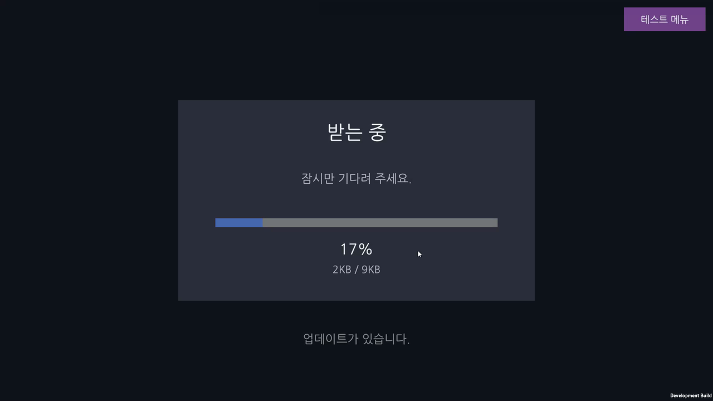 |

위 화면은 Windows 개발 빌드에서 네트워크를 실제로 끊고 시작한 결과입니다. 연결을 되살린 뒤 재시도하면 카탈로그 확인과 시작 콘텐츠 다운로드가 이어집니다.

다운로드가 도중에 끊기면 재시도를 표시하고, 다시 시도할 때 이미 받은 번들은 건너뜁니다. 이 경로는 모의 패치(PlayMode 테스트와 테스트 메뉴)로 확인했습니다.

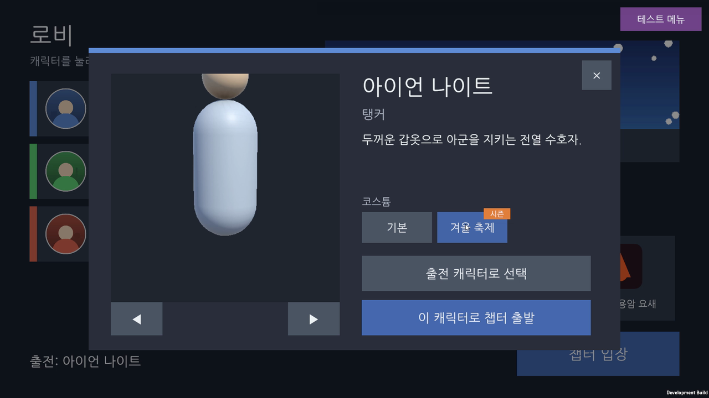

미리보기는 요청마다 번호를 붙입니다. 사용자가 다른 항목을 고르거나 팝업을 닫아도 진행 중인 Addressables 작업은 완료될 수 있습니다. 로더는 취소된 작업의 핸들을 완료 후 반환하고, 프레젠터는 전달받은 결과가 이미 지난 요청이면 인스턴스를 만들기 전에 반환합니다. [미리보기 프레젠터](Assets/LobbyFlow/Runtime/Preview/CharacterPreviewPresenter.cs), [Addressables 로더](Assets/LobbyFlow/Runtime/Loading/AddressablesPreviewAssetLoader.cs)

| 리소스 | 소유권과 반환 시점 |
|---|---|
| 미리보기 프리팹과 인스턴스 | 프레젠터가 소유하고, 미리보기 교체 또는 화면 닫기 시 반환 |
| 로비 초상, BGM, 배너 | 로비의 `AssetHandleSet`이 소유하고, 로비 화면 파괴 시 반환 |
| 챕터 씬 | 정상 로드 후에는 씬 언로드 시 Addressables가 반환하고, 로드 실패 시 씬 전환 코드가 반환 |
| 카탈로그와 다운로드 작업 | 패치 서비스가 결과를 읽은 뒤 반환 |

## 콘텐츠 업데이트와 빌드 검증

UI, 폰트, 기본 캐릭터와 데이터, 챕터 1은 로컬 그룹에 둡니다. 시즌 배너와 코스튬, 챕터 2와 3은 원격 그룹에 둡니다. v2에서는 원격 CSV와 프리팹을 추가해 앱 업데이트 없이 코스튬을 3개에서 4개로 늘렸습니다.

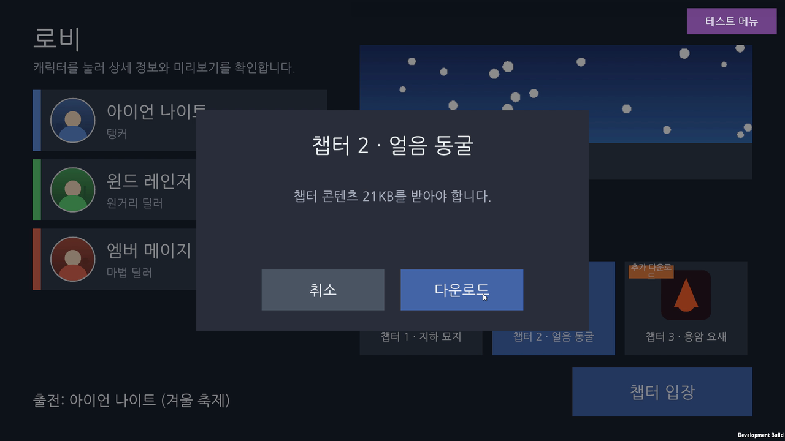

원격 챕터는 들어갈 때 받을 것이 남아 있으면 크기를 보여 주고 받은 뒤 진입합니다.

`main`의 v1 전체 빌드에서 만든 `addressables_content_state.bin`을 기준으로, `content/v2`의 원격 폴더 변경분을 콘텐츠 업데이트 빌드에 사용합니다.

Jenkins의 `content-release`는 플랫폼마다 v1 전체 빌드부터 v2 업데이트까지 한 실행에 묶고, CCD 업로드 후 공개 주소에서 카탈로그 해시와 파일 존재 및 크기를 검사합니다. [배포 파이프라인](Jenkinsfile), [Jenkins 설정 가이드](docs/guides/jenkins-setup.md)

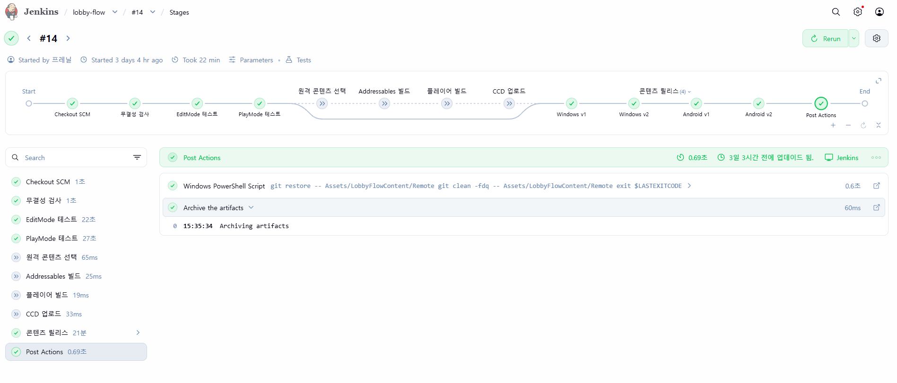

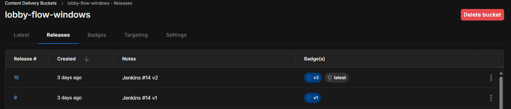

| 검증 범위 | 확인 결과 |
|---|---|
| Windows, 로컬 콘텐츠 서버 | v1 플레이어에서 v2 카탈로그 갱신과 변경된 번들만 다시 받는 동작을 서버 요청 로그로 확인 |
| Windows, Unity CCD | 카탈로그 갱신, 코스튬 추가, 챕터 2 재다운로드를 `Player.log`와 화면으로 확인. 개발 빌드의 v1/v2 배지 전환으로 양방향 갱신도 확인 |
| Android 실기기, Unity CCD | 겨울에서 봄으로 바뀐 배너, 신규 코스튬, 챕터 2 변경을 화면으로 확인. 기기별 번들 요청 내역은 미계측 |
| Windows 빌드 비교 | 동일 PC의 로컬 빌드와 Jenkins 작업 폴더에서 로컬 번들 13개, 원격 파일 9개 및 카탈로그 해시 일치 |
| Jenkins | Windows와 Android 콘텐츠 릴리스 실행 확인(#11, #14). 패키지 분리 후 검사 전용 실행에서 EditMode 27개, PlayMode 13개 통과(#17) |

[LocalServer 검증 기록](docs/records/2026-11-04-content-update-v2.md), [CCD 검증 기록](docs/records/2026-11-05-ccd-v1-v2.md)

## 문제를 좁힌 과정

동작 규칙과 완료 기준은 직접 정하고, AI는 반복 코드와 테스트 도구, CI 초안, 로그 분석에 활용했습니다. 다음 세 사례는 빌드 결과와 실행 기록을 바탕으로 검증 방법이나 설계를 바꾼 경우입니다.

1. **v1 플레이어를 고정해 업데이트를 검증했습니다.** 에디터에서 콘텐츠 업데이트를 빌드하면 로컬 카탈로그도 v2로 바뀌었습니다. v1 전체 빌드 직후 만든 Windows 플레이어를 보존하고, 서버 콘텐츠만 v2로 교체해 카탈로그 갱신과 요청 번들을 확인했습니다. [패치 검증 기록](docs/records/2026-11-04-content-update-v2.md)
2. **Windows 번들 차이를 셰이더까지 좁혔습니다.** 로컬과 Jenkins의 폰트 에셋은 같았지만 Windows 폰트 번들만 달랐습니다. 두 번들을 풀어 셰이더 블록을 비교해 DX11 디버그 정보에서 차이를 찾았습니다. TMP 셰이더에서 해당 지시문을 제거하고 무결성 검사로 재유입을 막았습니다. [CCD 검증 기록](docs/records/2026-11-05-ccd-v1-v2.md)
3. **변경하지 않은 챕터의 의존성도 확인했습니다.** v2 카탈로그를 비교하다 챕터 1 재질이 기존 재질 번들 대신 씬 번들을 가리키는 것을 발견했습니다. 씬과 재질을 묶었던 폴더 항목을 분리하고, 그룹 구성 규칙을 테스트로 추가했습니다. [그룹 구성 테스트](Packages/com.frenil.addressables-delivery/Tests/Editor/DeliverySetupTests.cs)

## 테스트와 패키지

- **EditMode와 CI 무결성 검사**에서 CSV와 Addressables 주소 및 라벨, 번들 중복, 원격 에셋 직접 참조, v2 변경 범위, 빌드 설정을 검사합니다. [EditMode 테스트](Assets/LobbyFlow/Tests/EditMode), [CI 무결성 검사](ci/integrity.ps1)
- **PlayMode**에서 미리보기 요청 경합, 실패 주입, 모의 패치 중단과 재시도, 캐시 유무 판정을 검사합니다. [PlayMode 테스트](Assets/LobbyFlow/Tests/PlayMode)
- 패키지 `com.frenil.addressables-delivery`에 시작 패치 서비스, 빌드와 업로드 도구, 그룹 검사, Jenkins 템플릿을 분리했습니다. [패키지 README](Packages/com.frenil.addressables-delivery/README.md), [새 프로젝트 적용 가이드](docs/guides/new-project-setup.md)

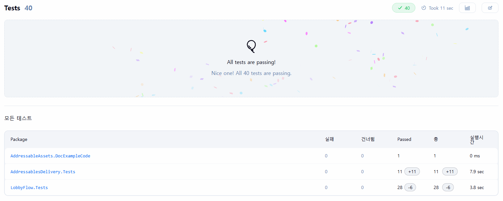

## 남은 검증

- 팝업 열기와 닫기, 씬 왕복을 각각 30회 반복하는 CSV 계측 도구는 구현했습니다. 플레이어의 반복 결과와 Addressables Profiler 및 Memory Profiler 캡처는 아직 수집하지 않았습니다. [반복 계측 도구](Assets/LobbyFlow/Runtime/Diagnostics/RepeatRunner.cs)
- 네트워크 중단은 Windows에서 시작 전에 끊은 경우만 실제로 확인했습니다. 다운로드 도중 끊김과 Android 실기기의 끊김은 검증 전입니다.
- 새 빈 프로젝트에 git 주소로 패키지를 설치하고 프로젝트에 적용과 설정 검사까지 확인했습니다. 그 프로젝트에서 원격 그룹 구성, 빌드, 업로드까지는 해 보지 않았습니다.
- iOS 빌드, 다른 PC에서의 번들 일치, Custom 저장소 실계정 업로드는 검증 전입니다.
- Windows와 Android 개발 빌드 다운로드는 공개 전입니다.

## 환경과 문서

Unity 6000.3.9f1, URP, Addressables 2.8.1, TextMeshPro, Input System, `com.frenil.uisystem`, Unity CCD, Jenkins.

- [프로젝트 사양](docs/SPEC.md)
- [MIT 라이선스](LICENSE)
